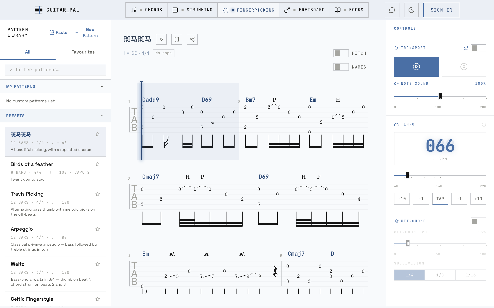
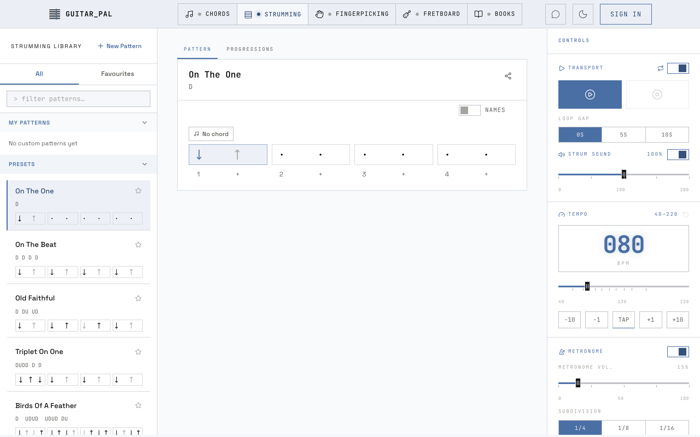

<p align="center">
  
</p>

<h1 align="center">Guitar Pal</h1>

<p align="center">
  A practice studio for guitar lovers who would rather play than squint at PDFs.<br/>
  <a href="https://guitarpal.sloanwan.com"><b>guitarpal.sloanwan.com</b></a>
</p>

<p align="center">
  
</p>

## What's inside

**Strum machine.** Build a rhythm, write chords over it, and hear it played on a
real guitar sample. The strings keep ringing into the next strum, so it sounds
like a guitar, not a drum machine with opinions.



**Fingerpick tabs.** Write a tab, play it back, loop the hard bar. Triplets, 6/8,
hammer-ons and slides all play, and every fret can show the note it sounds.

**Books.** Upload a guitar method PDF, scanned pages included. Guitar Pal finds
the chapters, reads the exercises off the page, and gives them back as drafts
you can check, fix and save as playable patterns.

**Chord library.** Hundreds of chords with several voicings each, and yes,
somebody checked the bass notes.

**Assistant.** Type `C G Am F, slow folk strum` or paste an ASCII tab and get
back a card you can press play on. Most of it is read by plain rules, not a
language model. The rules it follows are written down in
[docs/assistant-grammar.md](docs/assistant-grammar.md).

**Share links.** Send someone a pattern. They can play it without signing up.

**MCP server.** Connect `/api/mcp` to Claude, Cursor, VS Code or any other MCP
client and ask for a pattern or a tab; what the model writes comes back as a
link that plays. Setup and the tools are in [docs/mcp.md](docs/mcp.md).

Everything works without an account. Signing up just means your stuff is still
there tomorrow.

## Standing on

- [VexFlow](https://github.com/0xfe/vexflow): draws every tab stave
- [WebAudioFont](https://github.com/surikov/webaudiofontdata): the guitar samples, fetched at runtime
- [chords-db](https://github.com/tombatossals/chords-db): the chord voicings, audited and corrected here

## How it's built

- **Web app:** Next.js 16 (App Router), React 19, TypeScript in strict mode,
  Tailwind CSS v4, shadcn/ui on Radix.
- **Data and auth:** Supabase (Postgres, Auth, Storage), read through thin
  query functions in `src/lib/`, no ORM. A guest's work stays in the browser.
- **Audio:** the Web Audio API with a lookahead scheduler. Each string is its
  own sampled voice, scheduled ahead of time and left to ring.
- **Notation:** VexFlow draws the tab staves.
- **Assistant:** rule-based readers for strum and tab sentences
  (`src/lib/assistant/`). General mode runs a model (DeepSeek or Claude) that
  calls those same readers as tools, so every card comes from a reader. An
  offline eval set keeps score.
- **Book import:** `book-service/`, a Python service (FastAPI, asyncpg,
  LangGraph, PyMuPDF and Tesseract) the app proxies to. See its
  [README](book-service/README.md).
- **Tests and CI:** Vitest unit tests, a Playwright smoke suite and pytest for
  the book service, run by GitHub Actions on every pull request alongside
  CodeQL. A green `main` deploys to the server with Docker.

## Repo layout

```
src/app/         routes: the pages, auth, api/ (assistant, books proxy, MCP); dev/ labs are off in production
src/components/  feature components by area: strum, fingerpick, chords, assistant, books, …
src/lib/         the logic: pattern models, schedulers, chord data, assistant readers
book-service/    the Python book-import service
e2e/             Playwright suites
scripts/         SQL migrations and one-off data scripts
docs/            assistant grammar, MCP setup
```

## Running it locally

This is the source of [guitarpal.sloanwan.com](https://guitarpal.sloanwan.com),
not a package for self-hosting. The database structure is in
`scripts/schema.sql` (tables, indexes, RLS policies and grants; `psql -f` it into
a Supabase project of your own), but the chord library's rows are not, so the
chord pages start empty. Then:

```bash
cp .env.example .env.local   # fill in the Supabase URL and anon key
npm ci
npm run dev                  # http://localhost:3000
npm test                     # unit tests
npm run test:e2e             # Playwright smoke suite
```

## License

All rights reserved. See [LICENSE](LICENSE).
